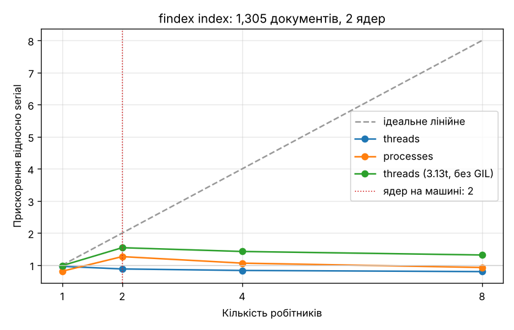

# findex

[](https://github.com/Mazurevych/findex/actions/workflows/ci.yml)

**Живий сайт:** <!-- live-url -->_ще не розгорнуто_<!-- /live-url -->

Навчальна пошукова система, яку я будую протягом курсу «Python» (8 лабораторних).
Автор: Мазуревич Яків, гр. БІ-125-23-3-Б, КАІ.

| Лаба | Тег | Що зроблено |
|---|---|---|
| 1. Ітератори, генератори, корпус | `lab-01` | потокове читання корпусу, токенізатор, статистика в сталій пам'яті — [розділ](#лаба-1--ітератори-генератори-та-корпус) |
| 2. Інвертований індекс | `lab-02` | індекс, Boolean-пошук AND/OR/NOT, збереження pickle + бінарний формат, дослідження пам'яті — [розділ](#лаба-2--інвертований-індекс-словники-хешування-та-память) |
| 3. Об'єктна модель і ранжування | `lab-03` | клас `Index`, TF-IDF і BM25, мова запитів з дужками й фразами, `@timed`, `lru_cache`, сніпети, precision@5 — [розділ](#лаба-3--обєктна-модель-і-ранжування) |
| 4. Типи, тести, пакування, CLI | `lab-04`, `v0.4.0` | pyright strict, 100+ тестів із Hypothesis, CLI `findex` на typer + rich, logging, CI — [розділ](#лаба-4--типи-тести-пакування-cli) |
| 5. Паралельність і GIL | `lab-05` | `build_partial` + `merge`, `--executor serial\|threads\|processes`, бенчмарк із графіком, Python 3.13t без GIL, гонка даних — [розділ](#лаба-5--паралельність-і-gil) |
| 6. Асинхронний краулер | `lab-06` | `findex crawl`: asyncio, `TaskGroup`, черга, семафори, robots.txt, повтори з backoff, бенчмарк 1/5/20 — [розділ](#лаба-6--асинхронний-краулер) |
| 7. Вебпошук на FastAPI | `lab-07`, `v0.7.0` | API `/search` `/docs/{id}` `/stats` `/health`, сторінка з підсвіченими сніпетами, Docker, Render, `oha` — [розділ](#лаба-7--вебпошук-на-fastapi) |

## Швидкий старт

```bash
uv sync                                        # .venv + typer, rich і dev-інструменти
uv run python scripts/get_corpus.py            # корпус у data/ (потрібен git)
uv run findex index data/ --out index.bin --positions   # паралельно процесами
uv run findex search index.bin '"context manager" NOT async' --k 5
uv run findex stats index.bin
uv run findex crawl https://www.python-httpx.org/ --max-pages 100   # див. лабу 6 про етику
uv run findex serve --index index.bin           # http://127.0.0.1:8000 і API на /docs
uv run pytest                                  # тести (+ --cov для покриття)
uv run ruff check . && uv run ruff format --check . && uv run pyright
```

Встановити як звичайну команду: `uv tool install .` (або з wheel — див. [лабу 4](#пакування-і-встановлення)).
Команди лаб 1–2 теж працюють: `python -m findex.stats data/` (статистика корпусу потоком,
параметри `--limit`, `--top`, `--mode lazy|eager`, `--no-trace`, `--json`),
`python -m findex.index ...` = `findex index ...`, `python -m findex.search ...` = `findex search ...`.

## Корпус

**Документація Python + PEP** — тексти, які мені справді корисно шукати під час навчання.

| Частина | Джерело | Документів | Обсяг |
|---|---|---:|---:|
| Документація Python (довідник, туторіал, HOWTO, What's New) | [`python/cpython`](https://github.com/python/cpython), каталог `Doc/`, файли `*.rst` | 560 | ~15 MiB |
| Python Enhancement Proposals | [`python/peps`](https://github.com/python/peps), `peps/pep-*.rst` | 745 | ~16 MiB |
| **Разом** | | **1 305** | **26.8 MiB, 28 млн символів** |

Один документ = один `.rst`-файл. Завантажити: `uv run python scripts/get_corpus.py`
(sparse-clone без історії, копіює лише `.rst` у `data/`). Вимірювання нижче зроблені на
знімку від 25.10.2026 (cpython `7b12a41`, peps `018ddd7`). Обидва джерела ростуть, тож
до кінця курсу корпус уже має ≥ 1 000 документів, як вимагається; у лабі 6 його доповнить краулер.

`data/` додано в `.gitignore` — корпус у git не потрапляє.

## Структура

```txt
src/findex/
  corpus.py     iter_documents(root) -> Iterator[Document] — генератор документів   (лаба 1)
  tokenize.py   tokenize(text) -> Iterator[str] — генератор токенів                 (лаба 1)
  stats.py      `python -m findex.stats`: статистика корпусу, eager vs lazy         (лаба 1)
  index.py      Posting, DocMeta, клас Index (Mapping), build_index                (лаби 2–3)
  merge.py      злиття відсортованих списків: merge і set                          (лаба 2)
  store.py      save/load: pickle і бінарний формат з mmap; open_index             (лаби 2–3)
  query.py      парсер запитів: Term, Phrase, And, Or, Not                         (лаба 3)
  scoring.py    протокол Scorer, TfIdf, BM25                                        (лаба 3)
  search.py     search(): збіг (lru_cache) -> оцінки -> heapq.nlargest             (лаба 3)
  snippets.py   сніпети з підсвіченими термами                                     (лаба 3)
  timing.py     декоратор @timed                                                   (лаба 3)
  cli.py        `findex index | search | stats | crawl | serve` (typer + rich)      (лаби 4, 6, 7)
  web/          FastAPI: settings, models, app (API + HTML), templates/, static/  (лаба 7)
  parallel.py   plan_chunks, build_partial, merge, build_parallel                  (лаба 5)
  sysinfo.py    пік RSS процесу (Linux, macOS, Windows)                            (лаба 5)
  crawler/      fetch, robots, urls, parse, crawl — асинхронний краулер            (лаба 6)
tests/          154 тести, conftest.py з фікстурним корпусом, 5 Hypothesis-властивостей
eval/queries.json  10 запитів з ручною розміткою релевантності                    (лаба 3)
scripts/
  get_corpus.py      завантаження корпусу
  benchmark.py       лаба 1: eager vs lazy
  repl_exercises.py  лаба 1: п'ять дослідів «Prove it to yourself»
  bench_index.py     лаба 2: пам'ять трьох варіантів постінгів, розмір файлу, save/load
  bench_search.py    лаба 2: merge vs set
  sanity_checks.py   лаба 3: три перевірки ранжування на корпусі
  evaluate.py        лаба 3: precision@5 для TF-IDF і BM25
  bench_parallel.py  лаба 5: serial / threads / processes (+ 3.13t), таблиця і графік
  _bench_once.py     лаба 5: один прогін в окремому процесі
  race_demo.py       лаба 5: гонка даних з GIL і без
  bench_io.py        лаба 5: I/O-обмежена задача — потоки масштабуються
  mirror_site.py     лаба 6: локальне HTML-дзеркало корпусу з «пастками»
  bench_crawl.py     лаба 6: краулер при concurrency 1 / 5 / 20
  finish-lab04.ps1   лаби 2–4: теги, wheel, uv.lock — кроки на власному ПК
  finish-lab06.ps1   лаби 5–6: оновлення uv.lock і теги
  finish-lab07.ps1   лаба 7: uv.lock, потім oha по живому сайту і теги
  bench_web.py       лаба 7: `def` vs `async def` для /search
  loadtest.py        лаба 7: oha — локально і задеплоєний сервіс
Dockerfile, render.yaml   лаба 7: двоетапний образ і Render Blueprint
.github/workflows/ci.yml   лаба 4: ruff, pyright, pytest на Ubuntu і Windows + збирання wheel
```

## Лаба 1 — ітератори, генератори та корпус

### `iter_documents`

`Document` — `NamedTuple(doc_id, path, text)`. Функція — генератор: `Path.rglob` лінивий,
кожен файл відкривається лише тоді, коли споживач попросить наступний документ, тож
`next(iter_documents(Path("data")))` повертається миттєво незалежно від розміру корпусу.

- Каталог: рекурсивно всі `.txt`, `.rst`, `.md` (і їхні `.gz` — розпаковуються потоково).
- Файл JSON-lines (`.jsonl`, `.jsonl.gz`): рядок = документ `{"id": ..., "text": ...}`;
  файл читається рядок за рядком.
- Не-UTF-8 файл не зупиняє обхід: попередження в лог і повторне читання з `errors="replace"`.
  Некоректний рядок JSONL пропускається з попередженням.

### Правила токенізатора

Конвеєр нормалізації: **NFC → `casefold()` → видалення «осиротілих» комбінованих знаків →
уніфікація апострофів**, далі `re.finditer(r"\w+(?:'\w+)*")`.

| Випадок | Рішення | Приклад |
|---|---|---|
| Регістр | `casefold()`, не `lower()` | `Straße`, `STRASSE` → `strasse` |
| Склад символів | Unicode NFC | `café` (U+00E9) і `cafe` + U+0301 → один токен `café` |
| Комбіновані знаки, що не склеїлись при NFC | видаляються | наголос: `за́мок` → `замок` (а не `за` + `мок`); `й`, `ї` не страждають |
| Апострофи | `’` `ʼ` `‘` `` ` `` → `'`; усередині слова — частина токена, на краях — відкидаються | `пʼять` → `п'ять`, `don't` → `don't`, `'hello'` → `hello` |
| Дефіси | розділяють | `e-mail` → `e`, `mail` (запит «mail» знайде «e-mail») |
| Цифри | окремі токени; крапка розділяє | `2026` → `2026`, `3.13` → `3`, `13` |
| Підкреслення | частина слова (як у `\w`) | `__init__`, `sys_path` — один токен: важливо для документації Python |
| Решта пунктуації | роздільник | `...!?` → нічого |

Окремо: `ʼ` (U+02BC) — офіційний український апостроф; без уніфікації `пʼять` і `п'ять`
були б різними термами.

### Результат на повному корпусі

```text
$ uv run python -m findex.stats data/
Документів:      1,305
Токенів:         3,906,497
Словник:         68,058 унікальних термів
Пікова пам'ять:  8.1 MiB (tracemalloc)
```

Топ-50 термів:

> the 207,177 · to 90,357 · a 89,902 · is 69,479 · of 67,052 · and 62,057 · in 56,887 ·
> for 45,504 · be 38,029 · this 36,127 · that 33,718 · **python 30,769** · as 27,972 · it 25,376 ·
> if 24,851 · are 23,548 · with 23,322 · or 23,217 · by 22,371 · an 22,043 · not 21,693 ·
> **class 21,027** · 3 19,271 · c 17,971 · on 17,779 · will 16,107 · **function 14,558** · 1 14,456 ·
> can 14,065 · from 14,065 · **pep 13,946** · **type 13,889** · object 12,507 · func 12,012 · 2 11,373 ·
> module 11,300 · use 11,218 · code 11,097 · 0 10,707 · which 10,478 · file 10,378 · method 10,360 ·
> return 10,331 · when 10,267 · value 9,892 · name 9,890 · new 9,567 · used 9,548 · data 9,407 · all 8,682

Верх списку — службові слова англійської (стоп-слова, ними займемось у лабі 3), але вже
в першій десятці з'являються предметні терми: `python`, `class`, `function`, `pep`.
`func` — це роль `:func:` з розмітки reStructuredText, а `3` — переважно «Python 3».

### Вимірювання: eager vs lazy

Обидві версії в `src/findex/stats.py`, результат однаковий (перевірено тестом):

- **eager** — `docs = list(...)`, потім `token_lists = [list(tokenize(d.text)) for d in docs]`, потім `Counter`;
- **lazy** — `Counter.update(tokenize(doc.text))` для кожного документа з потоку `islice(iter_documents(root), limit)`.

Машина: мій ноутбук, Windows, Python 3.13.17.
`uv run python scripts/benchmark.py data/ --limits 100 500 0 --repeat 3`
(кожен прогін — окремий процес; медіана з 3; «Час» — без tracemalloc).

| Версія | Документів | Токенів | Пікова пам'ять | Час | Час під tracemalloc |
|---|---:|---:|---:|---:|---:|
| eager (списки) | 100 | 180,472 | 10.6 MiB | 0.08 с | 0.28 с |
| lazy (генератори) | 100 | 180,472 | **1.5 MiB** | 0.08 с | 0.28 с |
| eager (списки) | 500 | 1,306,417 | 77.2 MiB | 0.65 с | 2.58 с |
| lazy (генератори) | 500 | 1,306,417 | **3.9 MiB** | 0.67 с | 2.55 с |
| eager (списки) | 1,305 | 3,906,497 | 234.1 MiB | 2.14 с | 8.59 с |
| lazy (генератори) | 1,305 | 3,906,497 | **8.1 MiB** | 2.22 с | 8.79 с |

**Чому так.** Eager-версія тримає в пам'яті одночасно три речі, і найбільша з них — зовсім не
тексти. Я заміряв tracemalloc після кожного кроку на повному корпусі: список документів займає
37.6 MiB (28 млн символів плюс заголовки рядків), а список списків токенів — **193.6 MiB**, тобто
в п'ять разів більше за сам текст. Причина в тому, що кожен із 3.9 млн токенів — окремий об'єкт
`str` (у середньому 46 байтів, з яких лише ~5 — самі літери, решта — заголовок об'єкта), плюс
8-байтовий вказівник на нього в списку (~30 MiB лише вказівників). Слово «the» зустрічається
207 тисяч разів, і в eager-версії це 207 тисяч окремих рядків. Сам `Counter` додав лише 1.9 MiB, бо
його ключі — посилання на вже наявні рядки. Тому пам'ять eager-версії росте лінійно з корпусом
(10.6 → 77 → 234 MiB). Лінива версія тримає лише поточний документ (найбільший — `tkinter.rst`,
0.25 MiB) з його нормалізованою копією, поточний токен і `Counter`, а кожен токен після
`counts.update` одразу стає сміттям, якщо такий терм уже є в словнику. Тому її пам'ять росте
не з корпусом, а зі **словником** (68 тис. термів ≈ 5.3 MiB у кінці). Пік 8.1 MiB, а не нуль,
бо: (1) `Counter` — це dict, і при розширенні його хеш-таблиці на мить існують і стара, і нова
таблиця; (2) поточний документ із нормалізованою копією; (3) сам інтерпретатор і модулі `re`,
`unicodedata`. За часом версії майже рівні: роботу (нормалізація + regex) обидві роблять ту саму,
лінивість економить пам'ять, а не CPU. tracemalloc сповільнює код у ~4 рази, бо перехоплює
кожну алокацію, тому час я міряв окремими прогонами без нього.

Важливо: tracemalloc рахує лише алокації Python-коду, а не весь RSS процесу.

Чому на 100 і 500 документах кількість токенів не кругла і відрізняється від інших машин:
`rglob` віддає файли в порядку файлової системи (на Windows/NTFS — за алфавітом, на Linux —
ні), тож «перші N документів» на різних ОС — різні документи. На повному корпусі числа
однакові скрізь: 1 305 документів і 3 906 497 токенів.

### Тести

`uv run pytest` — 16 тестів: 9 у `test_tokenize.py` (регістр і `casefold`, кирилиця, `café`
двома способами, осиротілий наголос, апострофи, дефіси, цифри та `_`, порожній рядок і
чиста пунктуація, генераторність) і 7 у `test_corpus.py` (генераторність `iter_documents`,
битий UTF-8, `.gz`, JSONL, `eager == lazy`, `--limit`, CLI).

### Stretch (частково)

`iter_documents` читає стиснуті `.txt.gz` / `.rst.gz` / `.jsonl.gz` без розпакування на диск.

## Лаба 2 — інвертований індекс: словники, хешування та пам'ять

```bash
uv run python -m findex.index data/ --out index.bin                 # побудувати і зберегти
uv run python -m findex.search index.bin "generator expression"     # неявний AND
uv run python -m findex.search index.bin "asyncio OR threading"
uv run python -m findex.search index.bin "asyncio NOT threading" --engine set
uv run python -m findex.search index.bin "NOT deprecated" --mmap
```

Параметри `findex.index`: `--out` (файл; `.pkl` → pickle, інше → бінарний формат),
`--format binary|pickle`, `--layout dataclass|slots|array`, `--positions`, `--limit N`, `--json`.
Обидві команди друкують час і пікову пам'ять (tracemalloc).

### Індекс

`build_index` (`src/findex/index.py`) споживає лінивий конвеєр лаби 1 і за **один прохід** будує:

- `postings: dict[str, list[Posting]]` — терм → список `Posting(doc_id, tf)`;
- `doc_lengths: dict[int, int]` — кількість токенів у документі (для BM25 у лабі 3);
- `doc_meta: dict[int, DocMeta]` — шлях і заголовок для показу результатів
  (заголовок береться з `Title:` у PEP або з підкресленого `===` заголовка в документації).

Для кожного документа рахується `Counter` його токенів, після документа він «скидається» в
`defaultdict(list)` постінгів. `doc_id` видаються послідовно (`enumerate`), тому кожен
список постінгів **автоматично відсортований**: ми лише дописуємо в кінець більші `doc_id`.
Корпус, як і в лабі 1, тече потоком — у пам'яті росте лише індекс.

`Posting` і `DocMeta` — `@dataclass(frozen=True, slots=True)`: незмінні, тому хешовані
(тест кладе їх у `set`), і без `__dict__` у кожного екземпляра. Прапорець `--positions`
додає в кожен постінг кортеж позицій токенів (для фразового пошуку в лабі 3).

### Boolean-пошук: merge і set

Запит обчислюється зліва направо: `слово слово` — неявний AND, плюс `OR` і `NOT`
(оператори великими літерами). Кожне слово запиту проходить той самий `tokenize`, що й корпус.
У лабі 3 цей простий розбір замінено справжнім парсером з дужками й фразами — див. нижче.

- `--engine merge` — двовказівникове злиття відсортованих списків (`src/findex/merge.py`): `intersect`, `union`,
  `difference`, O(len(a) + len(b)), без хешування;
- `--engine set` — `sorted(set(a) & set(b))` тощо.

Результати обох рушіїв однакові (тест на 200 випадкових парах списків).

`uv run python scripts/bench_search.py index.bin` — найкращий час із 5 серій `timeit`:

| Терми | df | Операція | merge | set | Хто швидший |
|---|---|---|---:|---:|---|
| 2 найчастіші: `the`, `in` | 1297, 1280 | AND | 141.0 мкс | 97.2 мкс | set ×1.5 |
| 2 найчастіші: `the`, `in` | 1297, 1280 | OR | 144.6 мкс | 104.8 мкс | set ×1.4 |
| 2 найчастіші: `the`, `in` | 1297, 1280 | NOT | 127.1 мкс | 71.8 мкс | set ×1.8 |
| 2 найрідкісніші: `printerr`, `cdecimal` | 1, 1 | AND | 0.2 мкс | 0.3 мкс | merge ×1.7 |
| 2 найрідкісніші: `printerr`, `cdecimal` | 1, 1 | OR | 0.4 мкс | 0.4 мкс | set ×1.1 |
| 2 найрідкісніші: `printerr`, `cdecimal` | 1, 1 | NOT | 0.2 мкс | 0.3 мкс | merge ×1.7 |
| частий + рідкісний: `the`, `printerr` | 1297, 1 | AND | 33.4 мкс | 26.9 мкс | set ×1.2 |
| частий + рідкісний: `the`, `printerr` | 1297, 1 | OR | 48.7 мкс | 50.6 мкс | merge ×1.0 |
| частий + рідкісний: `the`, `printerr` | 1297, 1 | NOT | 48.6 мкс | 53.6 мкс | merge ×1.1 |

**Висновок.** За асимптотикою обидва способи O(n + m), але в CPython **set виграє на довгих
списках**: побудова множини й перетин виконуються циклом на C, а кожен крок merge — це
кілька байт-кодових інструкцій інтерпретатора (порівняння, `+= 1`, `append`). На крихітних
списках (df = 1) merge трохи швидший, бо не платить за створення двох множин і `sorted`.
Пара «частий + рідкісний» показова: AND-злиття зупиняється, щойно закінчився короткий
список, тож його час залежить від того, *де* лежить єдиний `doc_id` рідкісного терма
(`printerr` має `doc_id` 361 — це 28 % довгого списку, і merge майже наздогнав set; для терма з великим `doc_id`
він проходить майже всі 1 297 елементів і програє вчетверо). OR і NOT мусять пройти довгий
список повністю за будь-якого рушія — тут вони рівні. Справжні рушії тут роблять skip pointers або двійковий пошук
(`bisect`) по довгому списку — O(m log n) — і саме тому тримають постінги відсортованими:
злиття працює потоково, на стиснутих даних і розширюється до фразового пошуку,
а `set` вимагає мати весь список у пам'яті як хеш-таблицю.

### Збереження: два формати

`src/findex/store.py`, `save(index, path, fmt)` і `load(path, lazy=False)`; формат
визначається за першими байтами файлу.

1. **pickle** (`.pkl`) — один виклик, будь-які Python-об'єкти. **Небезпечний для чужих файлів:**
   pickle — це програма для маленької віртуальної машини, інструкція `REDUCE` викликає
   довільну функцію з довільними аргументами (через `__reduce__` автор файлу може вказати
   хоч `os.system`), і код виконується прямо під час `pickle.load`. Тому `load_pickle`
   використовується лише для індексів, які ми створили самі. `load` відмовляється від
   файлу, що не є ні нашим бінарним форматом, ні pickle.
2. **Бінарний формат** (`.bin`) — безпечний (лише `json.loads` і `array.frombytes`):
   `FINDEX02` + довжина заголовка + JSON-заголовок (метадані документів і
   терм → [зсув, кількість постінгів, кількість позицій]) + тіло з масивів `array('I')`.
   Завантажується повністю або через **`mmap`** (`--mmap`): тоді з диска читаються лише
   постінги термів із запиту.

Знахідка під час роботи: `python -m findex.index` виконує модуль як `__main__`, і pickle
записав би у файл клас як `__main__.Index` — інший процес його не знайде. Тому точка
входу нічого не будує сама, а передає керування в `findex.cli` (з лаби 4 — команда `findex index`).

### Дослідження пам'яті (M4)

`uv run python scripts/bench_index.py data/` — кожна побудова й завантаження в окремому
процесі; load — медіана з 3 запусків без tracemalloc.
Машина: Linux x86_64, Intel Xeon 2.1 GHz, Python 3.13.

| Постінги | Формат | Пік пам'яті (побудова) | Індекс у пам'яті | Файл | Save | Load |
|---|---|---:|---:|---:|---:|---:|
| `list[Posting]`, звичайний `@dataclass` | pickle | 96.6 MiB | 94.6 MiB | 18.7 MiB | 1781 мс | 749 мс |
| `list[Posting]`, `slots=True` | pickle | 64.4 MiB | 62.4 MiB | 13.9 MiB | 3466 мс | 2227 мс |
| `array('I')` пари (doc_ids, tfs) | pickle | 31.6 MiB | 27.6 MiB | 10.8 MiB | 340 мс | 184 мс |
| `array('I')` пари, бінарний формат | binary | 31.6 MiB | 27.6 MiB | 8.3 MiB | 131 мс | 157 мс |
| `array('I')` пари, бінарний формат + mmap | binary (mmap) | 31.6 MiB | 27.6 MiB | 8.3 MiB | 131 мс | 56 мс |
| `slots=True` + позиції | pickle | 236.2 MiB | 233.9 MiB | 25.7 MiB | 6469 мс | 2773 мс |
| `array('I')` + позиції, бінарний формат | binary | 51.7 MiB | 48.7 MiB | 23.2 MiB | 181 мс | 217 мс |

Корпус: 1 305 документів, 68 058 термів, 844 265 постінгів, 3.9 млн позицій.

**Куди пішли байти.** Усі три варіанти зберігають ту саму інформацію — 844 тис. пар
(doc_id, tf), — тож різниця лише в «обгортці».
**Звичайний `@dataclass`:** кожен постінг — окремий об'єкт із заголовком (лічильник посилань,
тип, службові поля для збирача сміття) і місцем під атрибути-словник: ≈ 100 байтів, плюс
8 байтів — вказівник на нього в списку. Самі числа майже нічого не коштують: `tf` здебільшого
малі й кешовані CPython (−5…256), а `doc_id` один і той самий об'єкт для всіх термів документа.
**`slots=True`** прибирає місце під словник: об'єкт стає фіксованим — заголовок + 3 слоти по
8 байтів = 56 байтів, разом із вказівником ≈ 64 байти на постінг. Звідси −32 MiB (≈ 40 байтів ×
844 тис.). **`array('I')`** не створює об'єктів узагалі: постінг — це два «сирі» 4-байтові числа,
8 байтів, у 8 разів менше, ніж у `slots`. Решта ~21 MiB у рядку `array` — це вже не постінги,
а структура навколо них: 68 тис. рядків-термів, записи словника `postings`, два об'єкти `array`
на терм із запасом місця під дописування, `doc_meta` і `doc_lengths`. **Позиції** роблять
різницю ще разючішою: 3.9 млн позицій як Python-`int` (28 байтів, більшість > 256, тож не
кешовані) + 8 байтів вказівника в кортежі ≈ 36 байтів на позицію — +170 MiB; у `array` — 4 байти,
+21 MiB.
**Час.** pickle для `slots` повільніший, ніж для звичайного dataclass: незмінний slotted-dataclass
відновлюється Python-функцією `__setstate__`, яка для кожного поля викликає
`object.__setattr__`, а звичайний — одним копіюванням `__dict__` у C. `array` pickle зберігає
як суцільний блок байтів — у 10+ разів швидше. Бінарний формат найменший (немає імен
класів і полів) і найшвидший, а з `mmap` завантаження — це лише розбір JSON-заголовка:
постінги читаються з диска тільки для термів запиту.

### Тести лаби 2

`tests/test_index.py` (з лаби 4 — частина спільного набору): `Posting`/`DocMeta` frozen, slotted і хешовані; tf, df,
довжини документів і відсортованість постінгів для всіх трьох варіантів; позиції; заголовки;
merge дорівнює set на 200 випадкових парах; AND/OR/NOT/«NOT на початку»/«OR NOT» для
обох рушіїв; збереження → завантаження в обох форматах × 3 варіанти × з позиціями й без
× eager/mmap; відмова завантажувати невідомий файл.

### Stretch (частково)

Бінарний `mmap`-формат з JSON-заголовком реалізовано (`--mmap`). Gap-кодування ще ні.

## Лаба 3 — об'єктна модель і ранжування

```bash
uv run findex index data/ --out index.bin --positions          # позиції потрібні для фраз
uv run findex search index.bin '"global interpreter lock" NOT multiprocessing' --k 3
uv run findex search index.bin "(asyncio OR threading) NOT deprecated" --scorer tfidf
uv run findex -v search index.bin "dataclass" "dataclass"      # другий раз — з кешу
uv run python scripts/sanity_checks.py index.bin
uv run python scripts/evaluate.py index.bin --details
```

### Клас `Index` (M1)

Словники лаби 2 стали класом `Index(collections.abc.Mapping[str, PostingList])`
(`src/findex/index.py`): `len(ix)` — кількість термів, `"python" in ix`, `ix["python"]`
(`KeyError`, якщо терма немає), `for term in ix`, `repr(ix)` →
`<Index terms=68,058 docs=1,305 layout=array positions=True>`. Від `Mapping` безкоштовно
приходять `get`, `keys`, `items`, `values`. `__contains__` перевизначено, щоб для mmap-індексу
перевірка терма не декодувала його постінги. Статистика для ранжування: `num_docs`,
`avg_doc_length` (`functools.cached_property` — рахується один раз, хоча BM25 питає її для
кожного документа), `doc_length(doc_id)`, `df(term)`.

`Mapping` визначає `__eq__` за вмістом, тому `__hash__` став би `None`. Індекс — великий
ресурс із відкритим mmap, тож рівність і хеш у нього за ідентичністю: так його можна
передавати в `lru_cache`.

`open_index(path)` (`src/findex/store.py`) — контекстний менеджер на `@contextmanager`:
до `yield` — завантаження, після — `close()` у `finally`. mmap звільняється, навіть якщо
тіло `with` кинуло виняток (тест `test_open_index_closes_mmap_even_on_exception`).

### Ранжування: протокол `Scorer`, TF-IDF і BM25 (M2)

`src/findex/scoring.py`. `Scorer` — це `typing.Protocol` з одним методом
`score(term, posting, index) -> float`; `TfIdf` і `BM25(k1=1.5, b=0.75)` від нього **не
наслідуються**, вони підходять структурно, і pyright це перевіряє.

- TF-IDF: `tf · log(N / df)`
- BM25: `idf · tf·(k1+1) / (tf + k1·(1 − b + b·dl/avgdl))`, `idf = log(1 + (N − df + 0.5)/(df + 0.5))`

`search(index, query, scorer=BM25(), k=10)` (`src/findex/search.py`) знаходить документи
за деревом запиту, для кожного терма запиту (крім частин під `NOT`) додає `scorer.score(...)`
документам із цієї множини і бере `heapq.nlargest(k, ...)`, тобто O(n log k) замість
O(n log n) у `sorted(...)[:k]`. Результати — `SearchResult(doc_id, score, title, path)`
з `order=True`.

#### Три sanity-перевірки на корпусі

`uv run python scripts/sanity_checks.py index.bin`:

```text
1) Запит `python OR cdecimal`: df(python) = 1204, df(cdecimal) = 1
   TF-IDF: №1 — python-docs/using/windows.rst (Using Python on Windows); містить `cdecimal`: False
   BM25: №1 — peps/pep-0410.rst (Use decimal.Decimal type for timestamps); містить `cdecimal`: True
   idf BM25: python = 0.081, cdecimal = 6.769

2) Терм `generator` у peps/pep-0798.rst (tf = 84, довжина 5509):
   tf | BM25 score | приріст | TF-IDF score | приріст
    1 |      1.424 |  +1.424 |        1.964 |  +1.964
    2 |      2.207 |  +0.783 |        3.929 |  +1.964
    5 |      3.295 |  +1.087 |        9.822 |  +5.893
   10 |      3.942 |  +0.647 |       19.645 |  +9.822
   19 |      4.347 |  +0.405 |       37.325 | +17.680
   20 |      4.372 |  +0.025 |       39.289 |  +1.964
   20-те входження в BM25 дає 1.8% від внеску першого

3) Терм `walrus` один раз (tf = 1), avgdl = 2,993:
   короткий peps/pep-3136.rst                             довжина   2,106: BM25 5.116, BM25(b=0) 4.434, TF-IDF 4.466
   довгий   python-docs/library/ast.rst                   довжина  10,044: BM25 2.152, BM25(b=0) 4.434, TF-IDF 4.466
```

1. **Рідкісний терм важливіший за частий.** BM25 ставить першим документ із `cdecimal`
   (df = 1, idf 6.8), а не з `python` (df = 1204, idf 0.08). **TF-IDF цю перевірку на справжньому
   корпусі не проходить:** у нього частота не має стелі, і документ, де «python» трапляється
   сотні разів, набирає більше, ніж одне входження рідкісного терма. На маленькому
   прикладі з тестів (`test_rare_term_outranks_common`) TF-IDF перевірку проходить. Саме
   для цього BM25 і вводить насичення.
2. **Насичення tf.** У BM25 20-те входження `generator` додає 0.025, тобто 1.8 % від
   першого, а в TF-IDF кожне входження додає однаково (+1.964). Стеля BM25 — `k1 + 1`.
3. **Довжина документа.** Одне входження `walrus` у PEP 3136 (2 106 токенів) дає 5.1, а в
   `ast.rst` (10 044 токени) — 2.2. З `b = 0` і в TF-IDF оцінки однакові: нормалізацію
   довжини вмикає саме параметр `b`.

Усі три перевірки є також тестами в `tests/test_scoring.py`.

### Мова запитів (M3)

`src/findex/query.py` — рекурсивний спуск, по функції на рівень граматики:

```text
or_expr  := and_expr ("OR" and_expr)*
and_expr := unary (["AND"] unary)*        AND можна не писати
unary    := "NOT" unary | primary
primary  := "(" or_expr ")" | "фраза в лапках" | слово
```

Вузли `Term`, `Phrase`, `And`, `Or`, `Not` — frozen dataclass, тож `==` порівнює дерева;
`&`, `|`, `~` будують ті самі дерева в коді (`Term("a") & ~Term("b")`); у кожного вузла є
`evaluate(index)` і `str()`, з якого `parse` відновлює те саме дерево. AND зв'язує сильніше
за OR, як множення сильніше за додавання: `parse("a OR b c") == Or(Term("a"), And(Term("b"), Term("c")))`.
`x AND NOT y` обчислюється як різниця, без доповнення до всіх документів. Слова запиту
проходять той самий `tokenize`, що й корпус, тож «e-mail» стає фразою `"e mail"`.
Фрази перевіряють сусідство позицій і без `--positions` дають зрозумілу помилку.
Оператори пишуться великими літерами: `or` малими — це звичайне слово.

Тести парсера — це дерева, а не рядки (19 випадків у `tests/test_query.py`, плюс
Hypothesis-властивість `parse(str(tree)) == tree`).

### Декоратори, кеш, сніпети (M4)

- `@timed` (`src/findex/timing.py`, з `functools.wraps` і PEP 695 `[**P, R]`) стоїть на
  `build_index`, `save`, `load`, `search` і логує час на рівні INFO.
- `@functools.lru_cache(maxsize=256)` — на шляху «запит → doc_id» (`matching_doc_ids`).
  `findex search` приймає кілька запитів, тож кеш видно в одному процесі:

```text
$ uv run findex -v search index.bin '"context manager" NOT async' '"context manager" NOT async' --no-snippets
INFO findex.timing: load: 223.3 ms
INFO findex.search: match cache: hits=0 misses=1 size=1
INFO findex.timing: search: 1.9 ms
INFO findex.search: match cache: hits=1 misses=1 size=1
INFO findex.timing: search: 0.7 ms
```

- **Сніпети** (`src/findex/snippets.py`): вікно ±80 символів навколо місця, де зібралось
  найбільше різних термів запиту; терми підсвічуються (жовтим у терміналі, `«»` у `--json`).
  Позиції індексу рахують токени, а не символи, тому сніпет проходить тим самим регулярним
  виразом по тексту документа і нормалізує кожен збіг окремо. Так зберігаються позиції в
  оригінальному тексті та його регістр.

```text
$ uv run findex search index.bin '"global interpreter lock" NOT multiprocessing' --k 3   # вивід скорочено
│ 1 │ 9.99 │ Optimizing Global Variable/Attribute │ …believe the global interpreter lock will │
│   │      │ Access  peps/pep-0266.rst           │ protect values from being corrupted. In…  │
│ 2 │ 9.83 │ Python support for free threading   │ …called :term:`free threading` where the  │
│   │      │ python-docs/howto/free-threading-…  │ :term:`global interpreter lock` (GIL) is…  │
│ 3 │ 9.74 │ Simplified Global Interpreter Lock  │ PEP: 311 Title: Simplified Global         │
│   │      │ Acquisition for Extensions          │ Interpreter Lock Acquisition for…         │
```

### Оцінка якості: precision@5

`eval/queries.json` — 10 запитів, для кожного я **заздалегідь, до запуску ранжування** виписав
документи, які мають бути в топ-5. precision@5 = скільки з перших п'яти результатів
релевантні, поділене на 5. `uv run python scripts/evaluate.py index.bin`:

| # | Запит | Релевантних | P@5 TF-IDF | P@5 BM25 |
|---:|---|---:|---:|---:|
| 1 | `"pattern matching"` | 9 | 1.0 | 1.0 |
| 2 | `f-string` | 9 | 0.8 | 0.8 |
| 3 | `type hints` | 11 | 0.6 | 0.8 |
| 4 | `async await coroutine` | 8 | 0.6 | 0.6 |
| 5 | `"global interpreter lock"` | 10 | 0.6 | 0.6 |
| 6 | `dataclass` | 4 | 0.6 | 0.6 |
| 7 | `"context manager"` | 9 | 0.2 | 0.4 |
| 8 | `unicode normalization` | 5 | 0.8 | 0.8 |
| 9 | `"virtual environment"` | 7 | 0.8 | 0.8 |
| 10 | `"exception groups"` | 7 | 0.8 | 0.8 |
| | **Середнє P@5** | | **0.68** | **0.72** |

BM25 трохи кращий (0.72 проти 0.68). Виграш дають запити `type hints` (TF-IDF витягує
документи, де «type» просто трапляється дуже часто) і `"context manager"` (TF-IDF ставить
`decimal.rst` і PEP 567, де контекст-менеджери згадуються мимохідь, зате багато разів).
Обидва програють на `"context manager"`, бо фраза трапляється в десятках документів,
де контекст-менеджер — лише допоміжна деталь. Вибірка маленька, тож різниця в один-два
документи — це шум. Мета тут — звичка міряти якість ранжування, а не числом підтвердити гіпотезу.
`dataclass` має лише 4 релевантні документи, тож його максимум — 0.8.

## Лаба 4 — типи, тести, пакування, CLI

### Типи: pyright strict

`[tool.pyright] typeCheckingMode = "strict"`, `uv run pyright` → **0 errors, 0 warnings**, без
жодного `# type: ignore` у `src/`. `Scorer` і `PostingList` — `typing.Protocol`; конвеєр
типізовано через `Iterator` / `Iterable` (функції **приймають** `Iterable` — підійде і список, і
генератор, — а генератори **повертають** `Iterator`); назви рушіїв, скорерів і варіантів
зберігання — `Literal` (`type EngineName = Literal["merge", "set"]`); `@timed` — PEP 695
generic `def timed[**P, R](fn: Callable[P, R]) -> Callable[P, R]`, тож обгорнута функція
зберігає свою сигнатуру для pyright. Пакет позначено `py.typed`.
У тестах є два `# type: ignore` — обидва навмисні: тест перевіряє, що присвоєння в frozen
dataclass падає, і читає службовий `__dataclass_params__`.

### Тести

`uv run pytest` — **102 тести** (`tests/`):

| Файл | Що перевіряє |
|---|---|
| `conftest.py` | фікстурний корпус із 6 файлів (кирилиця, `.md`, `.txt`) і два session-індекси |
| `test_tokenize.py` | NFC, casefold, кирилиця, апострофи, дефіси, цифри |
| `test_corpus.py` | генераторність, битий UTF-8, `.gz`, JSONL, eager == lazy, CLI лаби 1 |
| `test_index.py` | записи frozen/slots/хешовані, tf/df/позиції для 3 варіантів, протокол `Index`, save/load 2 формати × 3 варіанти × позиції × mmap, `open_index` при винятку |
| `test_query.py` | 19 дерев парсера, оператори `& \| ~`, синтаксичні помилки, Boolean і фрази |
| `test_scoring.py` | три sanity-перевірки, протокол, top-k, `order=True`, влучання в кеш, `@timed` + `wraps`, сніпети |
| `test_properties.py` | **Hypothesis**: merge = операції над множинами; `tokenize` ідемпотентний; `parse(str(t)) == t`; закони де Моргана на індексі; + повільна версія на 1500 прикладів (`@pytest.mark.slow`) |
| `test_cli.py` | `typer.testing.CliRunner`: index / search / stats, `--json`, коди виходу 2 з одним рядком у stderr, `-v` пише лише в stderr |

`uv run pytest -m "not slow"` пропускає повільний тест (≈ 5 с).

**Покриття** — `uv run pytest --cov`: **91 %** рядків і розгалужень (1 074 інструкції, 258 гілок).

| Модуль | Покриття | Що не покрито і чому |
|---|---:|---|
| `merge.py`, `search.py`, `timing.py`, `tokenize.py` | 100 % | — |
| `index.py`, `query.py` | 96 % | захисні `raise` на неможливих шляхах (невідомий `layout`) |
| `scoring.py`, `stats.py`, `store.py` | 90–92 % | `__call__`-аліаси, ручний вивід `python -m findex.stats`, байтсвоп для big-endian машин, помилка «стара версія формату» |
| `snippets.py` | 87 % | помилки читання файлу для сніпета, документ без жодного збігу |
| `cli.py` | 83 % | красивий (не-JSON) вивід `findex stats` і прогрес-бар — він вмикається лише в справжньому терміналі, а `CliRunner` ним не є |
| `corpus.py` | 80 % | корпус з одного файлу, а не з каталогу |
| `__main__.py` | 0 % | виконується лише як `python -m findex` в окремому процесі |

### CLI: `findex index | search | stats`

`src/findex/cli.py`, typer + rich:

```text
findex [-v | -vv] index  CORPUS --out FILE [--positions] [--limit N] [--layout ...] [--format ...] [--json]
findex [-v | -vv] search INDEX QUERY... [--k 10] [--scorer bm25|tfidf] [--engine merge|set] [--json] [--mmap]
findex [-v | -vv] stats  INDEX [--top 50] [--json]
```

- `index` показує rich-прогрес-бар у stderr (лише в терміналі);
- `search` малює rich-таблицю: місце, оцінка, заголовок і шлях, сніпет із підсвіченими термами.
  `--json` друкує JSON lines у stdout, тож результат можна передати далі:
  `findex search index.bin asyncio --json | jq -r .path`;
- `stats` показує числа лаби 1 з готового індексу: документи, токени, словник і топ термів
  за кількістю входжень і документів;
- `-v` вмикає INFO (час і кеш), `-vv` — DEBUG. Логування налаштовується один раз — у callback
  кореневої команди — і йде в **stderr**, тому stdout лишається чистим;
- очікувані помилки (немає файлу, синтаксис запиту, чужий або старий файл індексу) дають один
  рядок `Помилка: ...` у stderr і код виходу **2**, без traceback.

### Пакування і встановлення

`pyproject.toml` (PEP 621): метадані, залежності `typer` і `rich`, група `dev` (pytest,
pytest-cov, hypothesis, pyright, ruff), налаштування ruff / pyright / pytest / coverage і
`[project.scripts] findex = "findex.cli:app"`. `uv.lock` закомічено — CI ставить рівно ті версії.

```bash
uv build                               # dist/findex-0.4.0-py3-none-any.whl і .tar.gz
uv tool install .                      # з вихідного коду
uv tool install dist/findex-0.4.0-py3-none-any.whl
uv tool install https://github.com/Mazurevych/findex/releases/download/v0.4.0/findex-0.4.0-py3-none-any.whl
findex --help
```

`[project.scripts]` під час встановлення створює в каталозі `bin/` (на Windows — `Scripts\findex.exe`)
маленьку програму-обгортку, яка імпортує `findex.cli` і викликає `app()`.

### CI

`.github/workflows/ci.yml` на кожен push і pull request: на **Ubuntu і Windows** — `uv sync --locked`,
`ruff check`, `ruff format --check`, `pyright`, `pytest --cov`; потім окрема задача збирає wheel,
встановлює його через `uv tool install` у чисту систему, запускає `findex --help` і зберігає
`dist/` як артефакт. Бейдж угорі README показує статус. Wheel для `v0.4.0` прикріплено до
[GitHub Release](https://github.com/Mazurevych/findex/releases/tag/v0.4.0).

## Лаба 5 — паралельність і GIL

```bash
uv run findex index data/ --out index.bin                              # processes × усі ядра
uv run findex index data/ --out index.bin --executor threads --workers 4
uv run findex index data/ --out index.bin --executor serial
uv run python scripts/bench_parallel.py run data/                      # бенчмарк (з GIL)
uv python install 3.13t
uv run --isolated --python 3.13t python scripts/bench_parallel.py run data/ --executors serial threads
uv run python scripts/bench_parallel.py render                         # таблиця і графік нижче
uv run python scripts/race_demo.py                                     # гонка даних
uv run python scripts/bench_io.py data/                                # I/O: потоки масштабуються
```

### Шматки, часткові індекси, злиття (M1–M2)

`src/findex/parallel.py`:

- `plan_chunks(root, n)` ділить **шляхи** файлів (а не прочитані тексти) на шматки, приблизно
  рівні за байтами, і **наперед** призначає кожному суцільний діапазон `doc_id`
  (`[first_doc_id, first_doc_id + n)`). Передати в інший процес список `Path` — копійки, а тексти
  довелося б серіалізувати й копіювати.
- `build_partial(doc_paths, root, first_doc_id, positions) -> PartialIndex` — функція **рівня
  модуля**: `ProcessPoolExecutor` передає в робітника не код, а ім'я `findex.parallel.build_partial`,
  тож лямбду чи вкладену функцію pickle не знайде. Повертає компактні `array('I')`, без
  об'єкта на постінг: менше байтів назад через pickle.
- `merge(partials) -> Index`: діапазони не перетинаються і йдуть по черзі, тож злиття постінгів
  терма — конкатенація в порядку шматків, і вона вже відсортована. Порядок термів дорівнює
  порядку першої появи, як у `build_index`.
- Обидві побудови рахують документ однією функцією `analyze_document`, і тест
  `test_all_executors_produce_byte_identical_index` перевіряє: **serial, threads і processes дають
  байт-у-байт той самий файл індексу**, що й послідовна `build_index` з лаби 4. На повному
  корпусі я перевірив це також SHA-256, з позиціями і без.
- `findex index --executor {serial,threads,processes} --workers N`; за замовчуванням `processes` ×
  кількість ядер — на всіх моїх замірах процеси виграють.
- Процеси стартують через **`spawn`** однаково на Linux, macOS і Windows. Помилка робітника
  піднімається в батьківському процесі з оригінальним traceback (для процесів — у
  `__cause__`); решта шматків у черзі скасовується (`cancel_futures=True`), без зависання
  (тест `test_worker_error_fails_loudly`).

**Помилка, на якій я це засвоїв.** Перший тестовий скрипт я написав без
`if __name__ == "__main__":`, і він упав із `RuntimeError: An attempt has been made to start a new
process before the current process has finished its bootstrapping phase`. Зі `spawn` кожен
робітник — новий інтерпретатор, який **імпортує головний модуль**, щоб знайти функцію. Без
запобіжника імпорт знову доходить до `build_parallel(...)`, і робітник сам намагається
запустити пул. Тому всі скрипти, що запускають процеси (`_bench_once.py`, `bench_parallel.py`),
мають цей запобіжник, а `findex` запускається через точку входу typer — це еквівалентно.

### Бенчмарк (M3)

Кожна конфігурація — окремий процес (`scripts/_bench_once.py`), 3 прогони, у таблиці медіана.
Час злиття і пік RSS батьківського процесу міряються окремо. CPU — це `process_time` батька
(для потоків воно включає всі потоки) плюс `thread_time`, який повідомляє кожен
робітник-процес. Побудова без позицій, layout `array`, без збереження у файл.

<!-- lab05-bench:start -->
Машина: Intel(R) Xeon(R) Processor @ 2.10GHz, 2 логічних ядер, 7.8 GiB RAM, Linux 6.18.44-fc-v233; Python 3.13.14t, 3.13.17. Корпус: 1,305 документів.

| Executor | Workers | Wall, с (медіана) | CPU, с | Пік RSS батька | Merge, с | Speedup | Прогонів |
|---|---:|---:|---:|---:|---:|---:|---:|
| serial | 1 | 3.40 | 3.36 | 75 MiB | 0.09 | 1.00× | 3 |
| threads | 1 | 3.54 | 3.49 | 94 MiB | 0.14 | 0.96× | 3 |
| threads | 2 | 3.86 | 3.81 | 106 MiB | 0.16 | 0.88× | 3 |
| threads | 4 | 4.07 | 4.09 | 128 MiB | 0.20 | 0.84× | 3 |
| threads | 8 | 4.26 | 4.30 | 152 MiB | 0.18 | 0.80× | 3 |
| processes | 1 | 4.20 | 3.71 | 106 MiB | 0.16 | 0.81× | 3 |
| processes | 2 | 2.69 | 4.01 | 109 MiB | 0.21 | 1.27× | 3 |
| processes | 4 | 3.20 | 4.48 | 124 MiB | 0.34 | 1.06× | 3 |
| processes | 8 | 3.67 | 4.73 | 139 MiB | 0.44 | 0.93× | 3 |
| serial (3.13t, без GIL) | 1 | 3.49 | 3.44 | 86 MiB | 0.11 | 1.00× | 3 |
| threads (3.13t, без GIL) | 1 | 3.54 | 3.52 | 99 MiB | 0.17 | 0.99× | 3 |
| threads (3.13t, без GIL) | 2 | 2.26 | 3.95 | 114 MiB | 0.21 | 1.54× | 3 |
| threads (3.13t, без GIL) | 4 | 2.45 | 4.33 | 140 MiB | 0.26 | 1.43× | 3 |
| threads (3.13t, без GIL) | 8 | 2.65 | 4.60 | 173 MiB | 0.33 | 1.32× | 3 |

Speedup — відносно `serial` того самого інтерпретатора. CPU = процес-батько + звіти робітників-процесів.


<!-- lab05-bench:end -->

### Пояснення: чому так (M4)

**Потоки з GIL не прискорили нічого, а навіть сповільнили** (×0.8–0.95). Індексація — чистий
CPU: регулярний вираз, `casefold`, словники. GIL — один замок на весь інтерпретатор: байт-код
Python у кожен момент виконує лише один потік. Вісім потоків по черзі передають один одному
GIL (кожні 5 мс або на блокуючому виклику): поки один токенізує, сім чекають. Сумарний CPU
не росте, бо одночасно працює одне ядро, а wall росте через накладні витрати на
перемикання. Пік RSS при цьому росте (94 → 152 MiB): усі вісім часткових словників живуть
одночасно, а виграшу немає.

**Процеси масштабуються** (×1.3 на 2 ядрах при 2 робітниках). У кожного процесу свій
інтерпретатор і свій GIL. Але вони мають ціну, видиму в таблиці: CPU (≈ 4.0 с) більший за
wall (≈ 2.7 с) і більший за послідовний CPU (≈ 3.4 с). Зайві ≈ 0.6 CPU-секунди пішли на старт
інтерпретаторів через `spawn` (імпорт `findex`, `re`, `unicodedata` у кожному робітнику), на
**pickle** часткових індексів назад до батька (мегабайти масивів і рядків-термів) і на те,
що батько їх розпаковує. При 4 і 8 робітниках на 2 ядрах процесів більше, ніж ядер, і час
знову росте.

**Закон Амдала**: прискорення ≤ 1 / (s + (1 − s)/N), де s — частка, яка не розпаралелюється.
У мене однопотокові планування (пошук файлів і `stat`, 0.015 с) і **злиття**. Злиття росте з
кількістю шматків: 0.09 с для 1 шматка, 0.21 с для 8, 0.44 с для 31, бо що більше шматків, то
більше конкатенацій і термів, які зустрічаються в кількох шматках. При 8 шматках
s ≈ (0.015 + 0.21) / 3.4 ≈ 6.5 %, тож стеля ≈ 15× навіть на нескінченній кількості ядер. Амдал вплинув і на дизайн: з layout `slots` злиття
мусило ще перетворити 844 тис. постінгів на об'єкти `Posting` (1.4–1.9 с, s ≈ 35 % → стеля
лише ≈ 2.9×). Тому для паралельної побудови layout за замовчуванням — `array`, а файл на диску
однаковий в обох випадках.

**Free-threaded Python 3.13t** (рядки з позначкою 3.13t): GIL вимкнено (`sys._is_gil_enabled()
== False`), і ті самі потоки нарешті працюють на двох ядрах одночасно: ×1.5 при 2 робітниках,
**краще за процеси**, бо немає ні `spawn`, ні pickle. Часткові індекси вже лежать у спільній
пам'яті. Однопотокова швидкість 3.13t на моєму корпусі майже та сама, що з GIL.

**Гонка даних, яку показав 3.13t** (`scripts/race_demo.py`, 4 потоки):

| Що | З GIL (3.13) | Без GIL (3.13t) |
|---|---:|---:|
| `counter += 1`, 4 × 200 000, без замка | 800 000 з 800 000 (0 втрат) | **185 861** з 800 000 (77 % втрачено) |
| те саме з `threading.Lock` | 800 000 | 800 000 |
| спільний `dict`: `counts[t] = counts.get(t, 0) + 1`, 570 тис. токенів | **2 017 втрачено** | 5 382 втрачено |
| свій `Counter` у кожного потоку, злиття в одному потоці | 0 втрачено | 0 втрачено |

`counter += 1` — це чотири інструкції байт-коду: `LOAD_NAME`, `LOAD_CONST`, `BINARY_OP (+=)`,
`STORE_NAME`. Якщо два потоки прочитали те саме старе значення, обидва запишуть `старе + 1`,
і одне оновлення зникне. З GIL перемикання потоків стається лише в певних точках інтерпретатора,
тож на простому `+=` втрат не видно. Але найважливіший рядок — третій: наївний «спільний
словник частот» **губить токени навіть із GIL**, бо виклик `counts.get(...)` — саме така точка
перемикання. Тобто цей код **неправильний і на звичайному Python**: GIL лише рідше показує
помилку, а 3.13t її оголює. Виправлення двоє: `Lock` навколо читання-зміни-запису (повільніше:
0.03 → 0.11 с) або, як у findex, **прибрати спільний змінний стан**: кожен шматок рахує у
свої словники, а злиття робить один потік. Тому в `build_partial`/`merge` гонки немає за
побудовою, і на 3.13t індекс байт-у-байт той самий.

### Бонус: I/O-обмежена задача — тут потоки З GIL масштабуються

`scripts/bench_io.py`: 64 сторінки з локального дзеркала (лаба 6) з затримкою 100 мс ± 50 %,
звичайний блокуючий `urllib` у `ThreadPoolExecutor`. Python 3.13 **з GIL**, 2 ядра:

| Потоків | Wall, с (медіана з 3) | Сторінок/с | Speedup |
|---:|---:|---:|---:|
| 1 | 6.57 | 9.7 | 1.0× |
| 2 | 3.29 | 19.4 | 2.0× |
| 4 | 1.68 | 38.1 | 3.9× |
| 8 | 0.89 | 72.3 | **7.4×** |
| 16 | 1.14 | 56.1 | 5.8× |
| 32 | 1.19 | 53.8 | 5.5× |

Поки потік чекає відповіді з сокета, він **відпускає GIL**, тож вісім потоків чекають мережу
одночасно навіть на двох ядрах. Після 8 потоків приріст зникає: сервер-дзеркало працює в
тому самому процесі й теж бореться за GIL, а 64 сторінки на 16+ потоків — це вже по 2–4
запити на потік. Два бенчмарки, один урок: **CPU-задача → процеси (або 3.13t), очікування
вводу-виводу → потоки або asyncio** (лаба 6).

## Лаба 6 — асинхронний краулер

```bash
# 1) свій сайт: локальне дзеркало корпусу (в окремому вікні)
uv run python scripts/mirror_site.py data/ --port 8765 --latency 0.1
# 2) обхід -> JSON lines -> індекс -> пошук
uv run findex crawl http://127.0.0.1:8765/ --max-pages 300 --concurrency 20 --per-host 20 --delay 0 --out crawl/mirror.jsonl
uv run findex index crawl/mirror.jsonl --out crawl.bin --positions
uv run findex search crawl.bin '"type hints"'
uv run python scripts/bench_crawl.py data/          # бенчмарк 1 / 5 / 20
```

### Етика

Бенчмарк і демо краулять **локальне дзеркало** мого ж корпусу (`scripts/mirror_site.py` на
127.0.0.1). Це мій сервер, тож дозвіл є за визначенням, і цей варіант прямо названо в завданні.
Публічні сайти `findex crawl` обходить лише за правилами: перед першим запитом до хоста читає
його `robots.txt` і виконує `Disallow` і `Crawl-delay`; представляється чесним User-Agent
`findex-crawler/0.6 (+https://github.com/Mazurevych/findex; student search engine project, KAI;
respects robots.txt)`; за замовчуванням робить не більше 2 одночасних запитів до хоста з паузою
0.5 с між ними, не виходить за домен і шлях стартового URL (`--scope prefix`) і зупиняється
на `--max-pages`. Обходьте лише сайти, що це дозволяють, наприклад документацію бібліотек
проєкту (`https://www.python-httpx.org/`) з обмеженим бюджетом.

### Будова (`src/findex/crawler/`)

- **`fetch.py`** — `async def fetch(client, url, *, timeout=10.0) -> FetchResult` (статус, байти,
  час, кількість спроб, помилка). Кожен запит під `asyncio.timeout`. Повтори — **лише** для
  429, 5xx, таймаутів і обривів з'єднання, до 3 спроб, з паузою
  `min(cap, 0.5·2^(n−1)) + random(0, 0.5)` (експоненційний backoff + jitter). `Retry-After`
  (секунди або HTTP-дата) має пріоритет над backoff. На 404 та інші 4xx повторів немає, цикл
  переадресацій (`TooManyRedirects`) — теж без повторів. Ловляться лише конкретні помилки httpx і
  `TimeoutError`, тож `CancelledError` (а це `BaseException`) вільно проходить і скасування працює.
- **`robots.py`** — `RobotsCache`: `robots.txt` завантажується **один раз на хост**. 4xx означає,
  що обмежень немає, 5xx чи збій — що заборонено все. Тут потрібен `asyncio.Lock`: між «у кеші
  немає» і «поклали в кеш» стоїть `await`, і без замка 20 робітників, які одночасно прийшли на
  новий хост, завантажили б файл 20 разів (тест перевіряє: рівно один запит).
- **`urls.py`** — канонізація: схема й хост малими літерами, без порту за замовчуванням, без
  `#фрагмента`, з відсортованими параметрами запиту, із розкритими `.`/`..`. Кінцевий слеш
  нормалізується так: сегмент без крапки — це «каталог» (`/guide` → `/guide/`), а `/page.html`
  лишається як є. Множина `seen` зберігає канонічні URL, після переадресації туди додається і
  кінцевий URL. Крім того, там allowlist доменів і префікс шляху.
- **`parse.py`** — `html.parser` зі stdlib: заголовок, видимий текст (без `script`/`style`/`head`),
  посилання з урахуванням `<base href>`, `rel=nofollow` і `<meta name="robots" content="noindex,
  nofollow">`.
- **`crawl.py`** — `async def crawl(seeds, *, max_pages, concurrency, per_host, ...) ->
  AsyncGenerator[Page]`:
  - фронтир — `asyncio.Queue`, `concurrency` робітників у **`TaskGroup`**;
  - **глобальний семафор** обмежує запити в польоті загалом, **семафор на хост** — до одного
    сервера, а ще є мінімальна пауза між початками запитів до хоста (або `Crawl-delay`);
  - **бюджет**: робітник резервує місце до запиту, тож навіть при 20 робітниках завантажується
    рівно `max_pages` успішних сторінок, а не «плюс ті, що були в польоті»;
  - розбір HTML іде через `asyncio.to_thread`, щоб процесорна робота не тримала цикл подій.
    Індексація взагалі відбувається **після** обходу, окремою командою `findex index`;
  - **чиста зупинка**: при вичерпанні бюджету або фронтиру робітники скасовуються, задача-бігун
    чекає їх через `TaskGroup`, а клієнт закривається. Якщо робітник упав із багом,
    `ExceptionGroup` піднімається в споживача (тест `test_crawl_worker_bug_propagates`). Тест
    `test_crawl_drains_small_site_and_stops_cleanly` перевіряє, що після обходу в циклі подій не
    лишилося жодної задачі. Він знайшов у мене справжній «хвіст»: скасовану допоміжну задачу
    `out.get()`, яку я не дочекався.

### `findex crawl` (M3)

```text
findex crawl SEED-URL... [--max-pages 500] [--concurrency 10] [--per-host 2] [--delay 0.5]
             [--out data/crawl.jsonl] [--log crawl.log] [--scope prefix|domain] [--debug] [--json]
```

- кожна сторінка одразу пишеться одним рядком JSON (`id`, `url`, `title`, `text`, `fetched_at`)
  і `flush`-иться, тож нічого не накопичується в пам'яті. `iter_documents` з лаби 1 читає цей
  файл (поле `title` тепер теж підхоплюється), і `findex index` його індексує;
- живий індикатор `rich` у stderr: сторінки, сторінок/с, у польоті, у черзі, помилки,
  заборонено robots.txt;
- `crawl.log` — рядок на кожен URL і кожен повтор (статус, байти, час, кількість спроб);
- `--debug` запускає цикл з `asyncio.run(..., debug=True)`, і asyncio попереджає про кожен
  крок, що блокує цикл довше 100 мс.

### Бенчмарк (M4)

`uv run python scripts/bench_crawl.py data/`: локальне дзеркало із затримкою 100 мс ± 50 % на
запит, seed `/`, бюджет **200 сторінок**, медіана з 3 прогонів, сервер перезапускається перед
кожним прогоном. Машина та сама: 2 ядра Xeon, Python 3.13.

| Concurrency | Сторінок | Wall, с | Сторінок/с | Помилок | Макс. у польоті | Пік RSS |
|---|---:|---:|---:|---:|---:|---:|
| 1 (послідовно) | 200 | 34.41 | 5.8 | 2 | 1 | 47 MiB |
| 5 | 200 | 7.14 | 28.0 | 2 | 5 | 47 MiB |
| 20 | 200 | **3.46** | **57.7** | 2 | 20 | 48 MiB |
| 20, але per-host 2 + пауза 50 мс | 200 | 17.67 | 11.3 | 2 | 2 | 48 MiB |

Прогін із `debug=True` при concurrency 20 дав **0 попереджень** про блокування циклу (> 100 мс).
Я перевірив, що лічильник справді працює: корутина з `time.sleep(0.2)` дає 1 таке попередження.
Обидві «помилки» в кожному прогоні — навмисні: `/missing.html` (404) і цикл переадресацій.

**Чому concurrency 20 в одному потоці виграла в 10 разів, а потоки лаби 5 — ні.** У лабі 5 задача
була процесорна: поки один потік рахує, решта чекають на GIL, тож паралельності немає. Тут ≈ 99 %
часу кожного запиту — це **очікування мережі**. На `await` корутина віддає керування циклу подій,
і той за час однієї затримки встигає запустити ще 19 запитів. Процесор зайнятий мізерно,
тому одного потоку вистачає. Пам'ять майже не залежить від concurrency (47 → 48 MiB): корутина —
це кадр стеку на кілобайти, а не потік зі своїм стеком на мегабайти.

**Що коштують ліміти на хост і чому я їх лишив.** Останній рядок — та сама concurrency 20, але не
більше 2 запитів до хоста і 50 мс між ними: обхід у 5 разів повільніший. У дзеркала один хост,
тож саме ліміт на хост, а не глобальний ліміт, визначає швидкість: 20 робітників здебільшого
стоять у черзі на семафорі хоста. На чужому сервері я лишаю ліміт на хост і паузу 0.5 с за
замовчуванням: 20 одночасних запитів до одного сайту — це вже навантаження, схоже на атаку,
а 2 запити на секунду документаційний сайт навіть не помітить. Глобальний ліміт захищає мене (файлові
дескриптори, пам'ять), ліміт на хост — їх.

**Де цикл блокувався б, якби індексувати одразу.** Токенізація й побудова постінгів 200 сторінок —
секунди чистого CPU. Усередині корутини вони зупинили б цикл подій: усі 20 запитів у польоті
чекали б, з'єднання засинали б, таймаути спрацьовували б даремно. Тому розбір HTML іде в
`asyncio.to_thread`, а індексація — окремою командою після обходу (або, якщо дуже треба під час
обходу, в `ProcessPoolExecutor` через `loop.run_in_executor`).

**Оброблені збої — рядки з `crawl.log`** (обхід 200 сторінок, concurrency 20):

```text
INFO robots.txt disallows http://127.0.0.1:8765/private/secret.html
INFO retry http://127.0.0.1:8765/busy.html attempt=2/3 after 2.00s (HTTP 429; Retry-After 2s)
INFO retry http://127.0.0.1:8765/flaky.html attempt=2/3 after 0.88s (HTTP 503; backoff)
INFO 404 http://127.0.0.1:8765/missing.html 24B 0.157s attempts=1 error=HTTP 404
WARNING too many redirects http://127.0.0.1:8765/loop-a.html
INFO --- http://127.0.0.1:8765/loop-a.html 0B 0.641s attempts=1 error=too many redirects
INFO retry http://127.0.0.1:8765/flaky.html attempt=3/3 after 1.40s (HTTP 503; backoff)
INFO crawl done: 200 pages, 202 requests, 2 errors, 1 robots-blocked in 4.3s
```

На 429 краулер чекав рівно стільки, скільки попросив сервер (2 с), а не за своєю формулою.
На 503 повторював із паузами, що зростають (0.88 → 1.40 с, jitter робить їх неоднаковими),
і з третьої спроби отримав сторінку. На 404 і цикл переадресацій — жодного зайвого запиту.
Сторінку під `/private/` не завантажено взагалі. 200 сторінок за 202 запити: два «зайві» —
це повтори, а дублікатів немає (перевірено по журналу).

### Тести лаби 6

`tests/test_crawler.py`, 23 тести, усі на `httpx.MockTransport`, без мережі:
- `fetch`: 200; 503 → 503 → 200 з точними паузами backoff; 429 з `Retry-After: 7` і відмова після
  3 спроб; 404 без повторів; таймаут; цикл переадресацій; розбір `Retry-After` як HTTP-дати;
- канонізація (6 випадків), межі обходу, розбір HTML, `meta robots`;
- `RobotsCache`: правила, 404 → усе можна, 5xx → нічого, рівно 1 запит на хост при 20
  одночасних перевірках;
- `crawl`: рівно `max_pages`, жодної сторінки двічі, robots.txt, чужий домен; вичерпання
  маленького сайту і чиста зупинка; ліміти concurrency і на хост; пауза між запитами; баг у
  робітнику → `ExceptionGroup`;
- `findex crawl` через `CliRunner` → JSONL, який читає `iter_documents`, плюс журнал.
| Target | Route | Concurrency | RPS | p50 (ms) | p95 | p99 | 200 OK |
|---|---|---:|---:|---:|---:|---:|---:|
| local, 1 worker, `async def` | `/search` | 50 | 13.3 | 4728 | 4914 | 5039 | 150/150 |
| local, 1 worker, `def` | `/search` | 50 | 13.3 | 4598 | 5314 | 5347 | 150/150 |
| local, 4 workers | `/search` | 50 | 21.7 | 3026 | 4756 | 4856 | 276/276 |

## Лаба 7 — вебпошук на FastAPI

```bash
uv run findex serve --index index.bin                   # http://127.0.0.1:8000, API: /docs
uv run findex serve --index index.bin --workers 4 --handler async
docker build -t findex . && docker run --rm -p 8000:8000 findex
uv run python scripts/bench_web.py index.bin            # def vs async def
uv run python scripts/loadtest.py local index.bin       # oha, локально
uv run python scripts/loadtest.py remote https://<сервіс>.onrender.com
```

### API (M1)

`src/findex/web/` — FastAPI-застосунок, який створює `create_app(settings)`:

| Маршрут | Що повертає | Помилки |
|---|---|---|
| `GET /search?q=&k=&scorer=&page=` | `SearchResponse{query, scorer, total, page, k, pages, took_ms, results: [SearchHit{doc_id, title, path, score, snippet}]}` | 422 — неправильні параметри (`q` 1–500 символів, `k` 1…50, `page` 1…1000, `scorer` лише `bm25`/`tfidf`); 400 — синтаксис запиту; 503 — індекс не завантажено |
| `GET /docs/{doc_id}` | документ: заголовок, шлях, довжина, текст | 404 через `HTTPException`; 422 для `-1` |
| `GET /stats` | документи, терми, постінги, токени, розмір файлу, uptime, версія | |
| `GET /health` | `{"status": "ok", "documents": 1305}` | 503 `{"status": "unavailable"}`, якщо індекс не завантажився |
| `GET /docs` | Swagger UI, згенерований з типів і Pydantic-моделей | |

- **`lifespan`** завантажує індекс **один раз** зі `Settings.index_path` (через mmap) і кладе в
  `app.state`; на завершенні закриває його. Якщо файлу немає, сервіс стартує, але `/health`
  повертає 503, і платформа не пускає на нього трафік.
- **Залежності**: `maybe_index` → `get_index` (503, якщо None), `settings_dep`. Маршрути не знають,
  звідки береться індекс, тож тести підміняють `maybe_index` через `dependency_overrides`.
- **Налаштування** — `pydantic-settings` лише зі змінних середовища або `.env` (`INDEX_PATH`,
  `CORPUS_ROOT`, `INDEX_MMAP`, `SEARCH_HANDLER`, `MAX_K`, `LOG_LEVEL`). У коді немає ні шляхів, ні
  секретів, тож той самий образ працює локально й на Render.
- **Pydantic — на межі**: моделі запиту й відповіді в `web/models.py`. Усередині лишаються
  dataclass з лаб 2–3: їх мільйони, і перевірка Pydantic там лише коштувала б часу.
- **Помилки** — JSON з полем `detail`. Middleware дає кожному запиту `X-Request-ID` (або бере з
  заголовка), логує `GET /search -> 200 14.6ms [rid=…]` і перетворює неочікуваний виняток на
  чисту 500 `{"detail": "внутрішня помилка сервера", "request_id": "…"}`, а traceback пише в
  журнал. Ця обробка знадобилась уже під час розробки: перша версія падала через
  `from __future__ import annotations` (рядкові анотації не бачили локальних змінних
  `create_app`), і замість traceback користувач бачив саме таку 500 з request id.
- `findex serve [--index] [--host] [--port 8000] [--workers 1] [--handler sync|async]` обгортає
  uvicorn, тож CLI лишається єдиною точкою входу. Налаштування передаються через змінні
  середовища, бо кожен із `--workers N` процесів створює застосунок сам.

### Тести і рішення `def` чи `async def` (M2)

`tests/test_web.py`, 18 тестів через `TestClient` з `dependency_overrides`: індекс береться з
фікстурного корпусу, без справжнього файлу. Перевіряються пошук, пагінація без повторів, фрази й
TF-IDF, сім випадків 422, 400 на синтаксис запиту, документ і 404, `/stats`, `/health` 200 і 503,
OpenAPI, чиста 500 з request id (і без тексту винятку у відповіді), HTML-сторінки, статичний CSS
і варіант `async def`.

`uv run python scripts/bench_web.py index.bin`: 20 одночасних `/search` (різні запити, щоб не
міряти кеш), а паралельно `/health` кожні 10 мс; медіана з 3 прогонів, 2 ядра, Python 3.13:

| Обробник | 20 запитів, wall, с | /search p50, мс | /search max, мс | /health p50, мс | /health max, мс |
|---|---:|---:|---:|---:|---:|
| `def` (пул потоків) | 1.26 | 1251 | 1254 | 6.3 | **548** |
| `async def` (цикл подій) | 1.23 | 1226 | 1226 | 2.5 | **1211** |

**Рішення: `def`.** Загальний час однаковий: пошук — це ≈ 60 мс чистого CPU, і GIL так чи
інакше виконує 20 пошуків по черзі. Різниця в тому, **хто чекає**. В `async def` пошук виконується
прямо в циклі подій і не має жодного `await`, тож поки йдуть 20 пошуків, цикл не обслуговує
**нічого**: `/health` чекав 1.2 с, тобто всю пачку. На Render це означало б, що платформа
вважатиме сервіс мертвим саме під навантаженням. В `def` FastAPI віддає пошук у пул потоків, і
цикл подій лишається вільним. `/health` все одно чекав до 0.55 с, бо його потоку теж потрібен
GIL, але це вдвічі менше. Тому `SEARCH_HANDLER=sync` стоїть за замовчуванням, а `async` лишився
для порівняння.

### Вебсторінка (M3)

Jinja2-шаблони `web/templates/`, CSS через `StaticFiles` (`/static/style.css`):
- `GET /` — пошуковий рядок, перемикач BM25/TF-IDF, результати з оцінкою, шляхом і сніпетом,
  де терми підсвічено `<mark>`; пагінація; приклади запитів на головній; темна тема за
  налаштуванням системи; мобільна верстка;
- `GET /doc/{doc_id}?q=…` — повний текст документа з підсвіченими термами запиту.

### Docker і розгортання (M4)

- **`Dockerfile`** у два етапи. `build` (образ `uv`) ставить залежності строго з `uv.lock`
  (`--frozen`, спершу без проєкту, щоб шар кешувався), сам пакет — не editable, скачує корпус
  через `scripts/get_corpus.py` і будує `index.bin` з позиціями. `runtime` (`python:3.13-slim`)
  містить лише `.venv`, корпус і індекс, без uv, git і компіляторів. Користувач **не root**
  (`findex`, uid 10001), є `HEALTHCHECK`, порт береться зі змінної `PORT`.
- **CI** (`.github/workflows/ci.yml`, задача `docker`) на кожен push збирає образ, запускає
  контейнер, чекає `/health`, робить пошук і перевіряє, що процес не root.
- **Render** (`render.yaml`, Blueprint): Docker, безкоштовний план, `healthCheckPath: /health`,
  змінні середовища; логи кожного запиту з request id видно в Render Dashboard → Logs.

### Навантажувальний тест (oha)

`uv run python scripts/loadtest.py local index.bin`: `oha -z 15s -c 50` на
`/search?q=asyncio+OR+generator&k=10`, той самий ноутбук-сервер (2 ядра Xeon, Python 3.13),
індекс через mmap, сніпети ввімкнено. Рядок `deployed` — Render free (0.1 CPU), `-c 20`.

<!-- lab07-load:start -->
| Target | Route | Concurrency | RPS | p50 (ms) | p95 | p99 | 200 OK |
|---|---|---:|---:|---:|---:|---:|---:|
| local, 1 worker, `async def` | `/search` | 50 | 13.3 | 4728 | 4914 | 5039 | 150/150 |
| local, 1 worker, `def` | `/search` | 50 | 13.3 | 4598 | 5314 | 5347 | 150/150 |
| local, 4 workers | `/search` | 50 | 21.7 | 3026 | 4756 | 4856 | 276/276 |
| deployed | `/search` | 20 | 1.5 | 59 | 26914 | 28715 | 6/26 |
<!-- lab07-load:end -->

**Як читати таблицю (зв'язок із лабами 5–6).**
- **`async def` ≈ `def` за RPS (13.3 обидва).** Робота CPU-обмежена, і в одному процесі її
  виконує один GIL, хоч у циклі подій, хоч у пулі потоків (лаба 5). Пул потоків не додає
  пропускної здатності, він лише не дає зупинити цикл подій (див. `/health` вище).
- **4 робітники → ×1.6 RPS** (13.3 → 21.7). Це процеси з лаби 5: у кожного свій інтерпретатор і
  свій GIL. На 2 ядрах стеля — ×2, а решту з'їдає те, що 4 процеси ділять 2 ядра.
- **p50/p99 у секундах — це черга, а не повільний пошук.** Один пошук займає ≈ 75 мс, але
  50 клієнтів одночасно стоять у черзі. За законом Літтла очікування ≈ concurrency / RPS =
  50 / 13.3 ≈ 3.8 с (виміряно 4.6), а з 4 робітниками 50 / 21.7 ≈ 2.3 с (виміряно 3.0). **p99
  з 4 робітниками нижчий**, бо замість однієї черги до одного GIL є чотири, які обслуговуються
  паралельно. Хвіст скорочується разом зі середнім.
- **Задеплоєний сервіс** працює на частці одного ядра, тож його RPS обмежує CPU платформи, а
  частину затримки додає мережа до Франкфурта. asyncio тут нічого не прискорить, бо, на відміну
  від краулера з лаби 6, сервер не чекає мережу, а рахує.
- Такий повільний (≈ 75 мс) пошук — привід для лаби 8: профілювання покаже, куди йде час.
